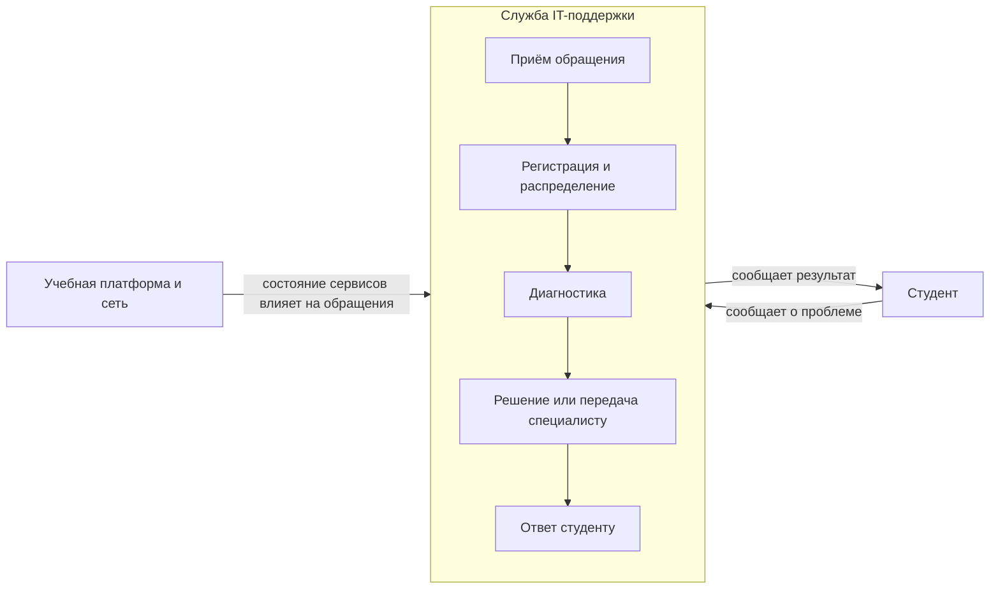

# Границы и цель системы

## Цель

Выбрать систему, которую вы будете разбирать весь семестр, провести её
границу и назвать цель — так, чтобы дальше было что анализировать.

## Почему это первая работа

Всё остальное в курсе опирается на это решение. Проведёте границу
слишком широко — утонете в связях, которые не можете наблюдать. Слишком
узко — не увидите причин поведения, они окажутся снаружи.

Граница системы не существует в природе. Её проводит аналитик, и от
того, где он её провёл, зависит ответ. Это первое, что стоит понять на
своей шкуре, а не из определения.

## Какую систему брать

Команда берёт тему из каталога курса — это темы проектов, которые делают
команды СИИ: разбор обращений в поддержку, учёт расходов, анонсы
мероприятий. Но разбираете вы не будущий продукт, а **систему, которая
стоит за темой сейчас**: как эту задачу решают сегодня, без него. Кто
этим занят, где, по каким правилам, что в этом повторяется.

Три условия, и все три — про возможность работать:

- к системе есть доступ: можно посмотреть, посчитать, спросить людей;
- в ней есть повторяющееся поведение: очереди, задержки, сбои, перегрузки;
- есть тот, кто ей управляет, — и с ним можно поговорить.

Если по выбранной теме сходить и посмотреть негде — выберите другую.
Разбор системы, которую нельзя наблюдать, превратится в пересказ
описания темы, и на приёмке это выяснится за две минуты.

## Темы проектов курса

Общий [список тем](topics.md) курса, из которого команда выбирает тему проекта.

## Подход к работе

Работать с файлами репозитория можно в браузере GitHub или локально в
редакторе с агентом. Настройка Zed и Codex описана в отдельной
[инструкции по настройке среды](../practicum/zed-agent-setup.md).

## Что сделать

1. Выберите систему и опишите её одним абзацем: что это и зачем
   существует.
2. Проведите границу. Что внутри системы, что снаружи, но влияет
   (среда), что вообще не при чём. Спорные элементы назовите спорными и
   объясните решение.
3. Найдите заинтересованные стороны: кто пользуется, кто управляет,
   кто обслуживает, кто страдает от сбоев. У каждой стороны — своя
   цель, и они не совпадают.
4. Сформулируйте цель системы и скажите, по чему видно, что она
   достигается. Не «работать эффективно», а то, что можно посмотреть.
5. Сходите и посмотрите. Один раз, с блокнотом. Запишите три
   наблюдения, которые вас удивили.

## Небольшой пример

Ниже — учебный пример системы, которая стоит за темой «IT-поддержка
университета». Это не описание конкретного университета: наблюдения
иллюстративны, и в своей работе их нужно заменить тем, что вы увидели
сами.

**Система:** служба, которая принимает обращения студентов о проблемах
с университетскими IT-сервисами, например с доступом к учебной платформе
или университетской сети, и помогает их решить.

**Граница:** внутри — приём и регистрация обращений, их распределение,
диагностика, решение или передача специалисту, сообщение результата.
Снаружи, но влияет, — студенты, учебная платформа и сеть университета:
студенты сообщают о проблеме, а состояние платформы и сети влияет на
поток обращений. В этой работе рассматривается именно служба поддержки,
а не устройство самой платформы или сети.

**Участники и их интересы:**

| Участник | Чего хочет |
|---|---|
| Студент | Быстро восстановить доступ и понимать, что происходит с обращением |
| Оператор поддержки | Получать достаточно сведений и распределять обращения без потерь |
| Руководитель поддержки | Справляться с потоком обращений и видеть повторяющиеся проблемы |
| Преподаватель | Чтобы технические сбои как можно меньше мешали занятиям |

**Цель системы:** помогать студентам решать проблемы с университетскими
IT-сервисами. Проверить, как работает поддержка, можно, например, по
медианному времени до первого ответа и доле обращений, которые не пришлось
открывать повторно в течение семи дней. Источник — журнал обращений;
конкретные значения нужно получить у службы, а не придумывать.

**Примеры наблюдений, которые можно проверить во время посещения:**

- студент сначала спрашивает знакомых или преподавателя, а уже потом
  обращается в поддержку;
- в обращении не всегда указано, на каком устройстве или в какой группе
  возникла проблема;
- оператор ждёт уточнения от студента, поэтому обращение временно
  останавливается.

Это заготовки для наблюдения, а не факты о вашем университете. Запишите,
что произошло, и при каких обстоятельствах; если такого не увидели,
укажите собственные наблюдения.

## Что сдать

- Контекстная диаграмма: система, её элементы, среда, внешние связи.
  Mermaid или картинка — на ваше усмотрение.
- Таблица заинтересованных сторон: кто и чего от системы хочет.
- Записка на одну страницу: цель системы, по чему видно её достижение,
  и три наблюдения из похода.

## Опора

Лекции 1 и 2.

## О чём спросят на приёмке

- Почему граница проведена здесь, а не шире на один элемент?
- Чья цель записана как цель системы — и что об этом сказали бы
  остальные стороны?
- Что вас удивило, когда вы пошли смотреть?
