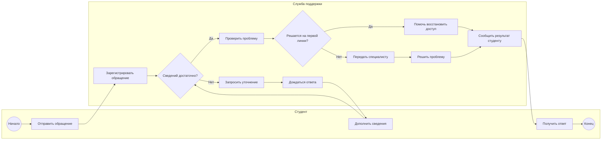
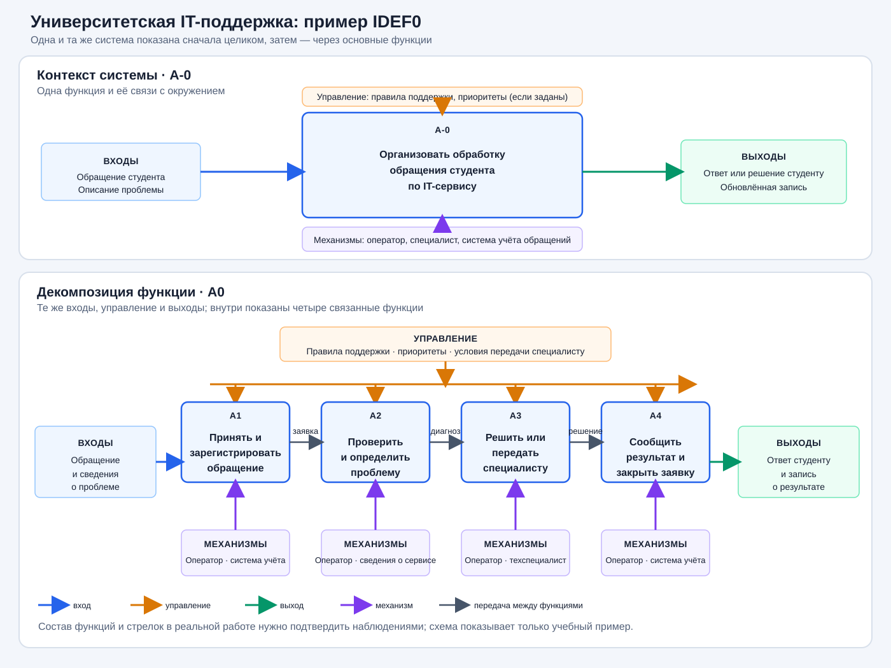

# Процесс как он есть

## Цель

Описать ключевой процесс системы и увидеть, чем его реальный ход
отличается от официального порядка работы.

## Продолжайте проект своей команды

Весь курс — один проект. В этой лабораторной продолжайте исследовать
**ту же тему и систему, которые выбрали в первой лабораторной**. Не
выбирайте новую систему. Используйте её границы, участников и цель из
первой работы, а также дерево целей и слабую ветку из второй. Выберите
процесс внутри границы системы, который помогает или мешает достигать
одной из этих целей. Если границу системы приходится уточнить, объясните
почему и внесите изменение в предыдущие материалы.

## Что сделать

1. **Выберите процесс.** Это повторяющаяся последовательность действий,
   которая влияет на работу системы. Выберите процесс, который можно
   наблюдать от начала до конца и который связан с целью или слабой веткой
   из второй лабораторной. Если он происходит редко, обсудите с
   преподавателем, можно ли изучить его по нескольким интервью и документам.
2. **Найдите описание процесса.** Это может быть регламент, инструкция,
   памятка или договорённость между участниками. Запишите название и
   источник. Если описания нет, поговорите с участниками о том, как
   «положено» работать, и укажите, что формального документа не нашли.
3. **Понаблюдайте за реальной работой.** Проследите процесс от события,
   которое его запускает, до результата. По возможности изучите несколько
   случаев: так будет проще отличить обычный ход от исключения. Записывайте,
   кто что делает, какие решения принимает, где ждёт и кому передаёт работу.
   Отмечайте, что увидели сами, а что узнали из разговора или документа.
4. **Постройте модель as-is** — схему того, как процесс происходит сейчас,
   а не того, как он должен происходить. Покажите начало и конец процесса,
   участников, действия, развилки и передачи работы.
5. **Сравните модель с описанием.** Укажите конкретные расхождения и
   предположите, почему они возникают. Причину, которую не удалось
   подтвердить разговором или наблюдением, обозначьте как гипотезу.

### Какую нотацию выбрать

Для последовательности действий, участников и развилок используйте **BPMN**.
Она лучше подходит, если нужно показать шаги, ожидания, возвраты и передачу
обращения между людьми. **IDEF0** показывает, какие функции выполняются,
что поступает на вход, что получается на выходе и чем управляется работа;
она не так подробно показывает последовательность шагов. Используйте IDEF0,
если именно такой взгляд нужен вашему процессу и вы можете объяснить выбор.

Для схемы BPMN подойдут Camunda Modeler или draw.io; для IDEF0 — draw.io.
Сохраните редактируемый файл (`.bpmn` или `.drawio`) и экспорт схемы в PNG
или PDF, чтобы её можно было посмотреть прямо в репозитории.

### Что записывать во время наблюдения

Для каждого шага отметьте:

- кто выполняет действие;
- что запускает шаг и что получается в результате;
- какое решение принимается и какие есть варианты;
- где возникает ожидание, возврат или передача другому участнику;
- откуда вы знаете об этом: наблюдали сами, прочитали в документе или
  узнали в разговоре.

Не включайте в отчёт имена, адреса, номера заявок и другие личные данные.
Перед просмотром переписки или внутренних документов получите разрешение.

## Небольшой пример

Это условный пример университетской IT-поддержки из первых двух лабораторных,
а не описание конкретного университета. В своей работе команда использует
собственную тему и собственные наблюдения.

**Процесс:** помочь студенту, который не может войти в учебную платформу.
Начало — студент сообщает о проблеме; конец — студент получил решение или
понятный ответ о дальнейших действиях.

**Возможный ход:** студент отправляет обращение → оператор регистрирует его
и уточняет сведения → проверяет состояние сервиса → либо помогает сам, либо
передаёт обращение специалисту → студенту сообщают результат.

**Возможные развилки для проверки:** если не хватает сведений, оператор
ждёт ответа студента; если проблема связана со сбоем платформы, обращение
передают специалисту; если доступ восстановлен, обращение закрывают.
Это варианты для поиска во время наблюдения, а не утверждение, что именно
так устроен процесс в вашем университете.

### Тот же пример в BPMN

Ниже — упрощённый эскиз: круги обозначают начало и конец, прямоугольники —
действия, ромбы — развилки, дорожки — участников. Он показывает ход
процесса; при сдаче перенесите свою модель в Camunda Modeler или draw.io.

В реальной модели проверьте по наблюдениям, действительно ли оператор
сначала регистрирует обращение, какие сведения нужны для проверки и кто
решает проблему после передачи специалисту.

### Тот же пример в IDEF0

Контекстная диаграмма **A-0** показывает функцию целиком, не расписывая
порядок шагов. Стрелки слева — входы, сверху — управление, справа — выходы,
снизу — механизмы выполнения. На верхней схеме показана функция целиком,
на нижней — её декомпозиция A0 на четыре функции. Подробности примера и
обозначения стрелок можно открыть в [SVG в исходном размере](idef0-example.svg).

Входы здесь — обращение и сведения о проблеме; правила и приоритеты
задают, как его обрабатывать; оператор, специалист и система учёта
помогают выполнить работу; результатом становятся ответ и запись о
результате. В декомпозиции внутренние стрелки показывают, что передаётся
между функциями. Состав стрелок уточните для своей системы.

| Как описано | Что наблюдали | Возможное объяснение |
|---|---|---|
| Все обращения регистрируются в системе учёта | Один студент сначала написал оператору в личный чат | Возможно, студентам неясно, куда обращаться. Это гипотеза, её нужно проверить у участников |

Заполните такую таблицу фактами из своей системы. Если расхождений не
нашлось, это тоже результат: укажите, какие случаи вы изучили и почему
считаете их достаточными.

## Что сдать

- Модель процесса as-is в формате `.bpmn` или `.drawio` и её экспорт в PNG
  или PDF. На схеме читаются начало и конец, участники, шаги, развилки и
  передачи работы.
- Короткий журнал наблюдений: сколько случаев изучили, когда и каким
  способом; отдельно отметьте наблюдения, сведения из документов и ответы
  участников.
- Записку или таблицу со сравнением официального порядка и реальной работы:
  конкретное расхождение, подтверждающий источник и возможная причина.
- Если формального описания нет или удалось изучить только один случай,
  укажите это и объясните, как это ограничивает выводы.

## Опора

Лекция 5.

## О чём спросят на приёмке

- Как этот процесс связан с системой и целями из первых двух лабораторных?
- Откуда вы знаете, что происходит именно так? Где и сколько случаев изучили?
- Покажите шаг, на котором возникает ожидание или возврат.
- Что в вашей схеме наблюдаемый факт, а что предположение?
- Почему участники отступают от описанного порядка именно здесь?
